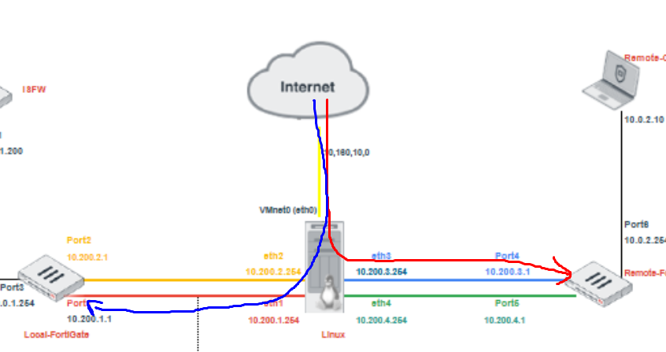

# 🛡️ Proyecto FortiGate

Repositorio y espacio de trabajo para administración, configuración, laboratorios y automatización de firewalls **FortiGate (FortiOS)** en entornos virtuales (PNETLab / EVE-NG) y redes de producción.

---

## 🔗 Repositorio Remoto (GitHub)

* **URL SSH:** `git@github.com:gdiazes/fortigate.git`
* **Estado de Conexión:** ✅ Verificado, autenticado y sincronizado con éxito vía SSH.
* **Rama Principal:** `main`

---

## 📐 Topología de Laboratorio

---

## 📁 Estructura del Proyecto

* **`img/`**: Diagramas y capturas de pantalla de las topologías de red.
* **`configs/`**: Respaldos y plantillas de configuración de FortiOS (`.conf`, scripts CLI).
* **`labs/`**: Topologías de laboratorio (PNETLab / EVE-NG), diagramas y planes de direccionamiento.
* **`scripts/`**: Scripts de automatización (Python, REST API de FortiOS, Ansible).
* **`docs/`**: Guías paso a paso, políticas de seguridad, VPNs, HA y notas técnicas.

---

## 📌 Objetivos y Casos de Uso

1. **Despliegue y Pruebas en PNETLab:** Integración de nodos FortiGate-VM64-KVM con routers, switches y zonas LAN/WAN.
2. **Políticas y Enrutamiento:** Firewall policies, NAT (SNAT/DNAT/VIP), SD-WAN, OSPF/BGP e interfaces VLAN.
3. **Seguridad y Perfiles:** Antivirus, IPS, Web Filtering, Application Control y SSL Inspection.
4. **Acceso Remoto y Conectividad:** VPN IPsec Site-to-Site y SSL-VPN para usuarios remotos.
5. **Automatización:** Consumo de la API REST de FortiOS con tokens de administración.
