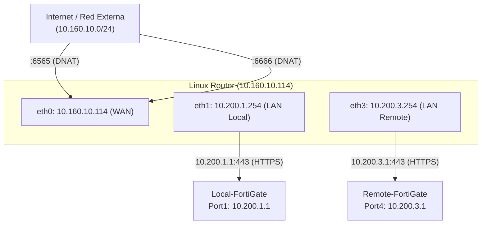

# 🌐 Guía de Configuración de NAT y Enrutamiento en Linux Router

Esta guía detalla la implementación de reglas de **Port Forwarding (DNAT)** y **Enrutamiento** en el servidor Linux Router (`10.160.10.114`) para permitir la administración remota de los firewalls FortiGate desde la red externa/Internet.

---

## 📐 Topología de Referencia (`img/nat.png`)



### Tabla de Direccionamiento y Mapeo de Puertos

| Dispositivo Destino | Interfaz Entrada (Linux) | IP Destino Interna | Puerto Externo (WAN) | Puerto Interno (FortiOS) | URL de Acceso |
| :--- | :--- | :--- | :--- | :--- | :--- |
| **Local-FortiGate** | `eth0` (`10.160.10.114`) | `10.200.1.1` (vía `eth1`) | **`TCP 6565`** | `TCP 443` (HTTPS) | `https://10.160.10.114:6565` |
| **Remote-FortiGate** | `eth0` (`10.160.10.114`) | `10.200.3.1` (vía `eth3`) | **`TCP 6666`** | `TCP 443` (HTTPS) | `https://10.160.10.114:6666` |

---

## 🛠️ Comandos a Ejecutar en el Linux Router (`10.160.10.114`)

Ingresa por consola o terminal al servidor Linux Router como usuario `root`:

### Paso 1: Habilitar el Reenvío de Paquetes en el Kernel (IP Forwarding)

```bash
sysctl -w net.ipv4.ip_forward=1
sed -i '/net.ipv4.ip_forward/d' /etc/sysctl.conf
echo "net.ipv4.ip_forward=1" >> /etc/sysctl.conf
```
* **Explicación:** Permite que Linux funcione como enrutador pasando paquetes entre `eth0`, `eth1` y `eth3`.

---

### Paso 2: Aplicar las Reglas de DNAT (Port Forwarding)

```bash
# Redireccionar puerto 6565 hacia Local-FortiGate (10.200.1.1:443)
iptables -t nat -A PREROUTING -p tcp -d 10.160.10.114 --dport 6565 -j DNAT --to-destination 10.200.1.1:443

# Redireccionar puerto 6666 hacia Remote-FortiGate (10.200.3.1:443)
iptables -t nat -A PREROUTING -p tcp -d 10.160.10.114 --dport 6666 -j DNAT --to-destination 10.200.3.1:443
```

---

### Paso 3: Permitir el Tráfico en la Cadena FORWARD

```bash
iptables -A FORWARD -p tcp -d 10.200.1.1 --dport 443 -m state --state NEW,ESTABLISHED,RELATED -j ACCEPT
iptables -A FORWARD -p tcp -d 10.200.3.1 --dport 443 -m state --state NEW,ESTABLISHED,RELATED -j ACCEPT
iptables -A FORWARD -m state --state ESTABLISHED,RELATED -j ACCEPT
```

---

### Paso 4: Enmascaramiento (MASQUERADE / SNAT) Bidireccional

```bash
# Enmascarar hacia los FortiGates para garantizar retorno directo al router
iptables -t nat -A POSTROUTING -o eth1 -d 10.200.1.1 -p tcp --dport 443 -j MASQUERADE
iptables -t nat -A POSTROUTING -o eth3 -d 10.200.3.1 -p tcp --dport 443 -j MASQUERADE

# Enmascarar tráfico saliente hacia Internet
iptables -t nat -A POSTROUTING -o eth0 -j MASQUERADE
```
* **Por qué es crucial el MASQUERADE interno:** Si los FortiGate no tienen aún configurada una ruta estática por defecto hacia el router Linux, el paquete parecerá provenir de `10.200.1.254` / `10.200.3.254`, garantizando que la respuesta regrese sin problemas de asimetría de rutas.

---

### Paso 5: Guardar y Persistir las Reglas

Para que no se pierdan al reiniciar el router:

```bash
apt update && apt install -y iptables-persistent
netfilter-persistent save
```

---

## 🔍 Verificación del Estado de las Reglas

Para comprobar que las reglas quedaron activas en la tabla NAT:

```bash
iptables -t nat -L PREROUTING -n -v --line-numbers
iptables -t nat -L POSTROUTING -n -v --line-numbers
```

---

## 🛡️ Configuración Requerida en los FortiGate (CLI)

En cada FortiGate, la interfaz conectada al Linux Router debe permitir el tráfico de administración HTTPS:

### En Local-FortiGate (vía consola):
```fortios
config system interface
    edit port1
        set ip 10.200.1.1 255.255.255.0
        set allowaccess ping https ssh http
    next
end

config router static
    edit 1
        set gateway 10.200.1.254
        set device port1
    next
end
```

### En Remote-FortiGate (vía consola):
```fortios
config system interface
    edit port4
        set ip 10.200.3.1 255.255.255.0
        set allowaccess ping https ssh http
    next
end

config router static
    edit 1
        set gateway 10.200.3.254
        set device port4
    next
end
```

---

## 🌐 Pruebas de Acceso desde el Navegador

Desde cualquier computadora conectada a la red `10.160.10.0/24`:
* **Local-FortiGate:** `https://10.160.10.114:6565`
* **Remote-FortiGate:** `https://10.160.10.114:6666`
